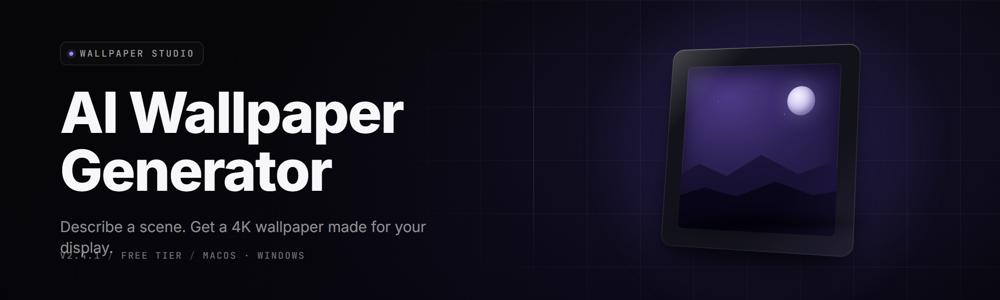

  
  
  

  

  
  
  

---

**Diffusion-powered desktop wallpaper generator for Windows. Type a prompt, pick a resolution, hit generate. Your GPU does the rest.**

---

## 🧭 Table of Contents

- [Overview](#-overview)
- [The Problem](#-the-problem)
- [The Solution](#-the-solution)
- [What is AI Wallpaper Studio](#-what-is-ai-wallpaper-studio)
- [Key Features](#-key-features)
- [Grouped Module Catalog](#-grouped-module-catalog)
- [System Requirements](#-system-requirements)
- [Compatibility](#-compatibility)
- [Tips for Best Results](#-tips-for-best-results)
- [All Modules Status](#-all-modules-status)
- [Comparison](#-comparison)
- [Known Issues](#-known-issues)
- [Installation](#-installation)
- [Quick Start](#-quick-start)
- [FAQ](#-faq)

---

## 📖 Overview

AI Wallpaper Studio is a standalone Windows `.exe` that turns text prompts into native-resolution desktop wallpapers using a local diffusion pipeline. No cloud, no subscription, no account. You type, it generates, it sets the wallpaper.

| Category | Details |
|---|---|
| **Product** | AI Wallpaper Studio — Pro 2026 |
| **Type** | Offline desktop wallpaper generator (`.exe`) |
| **Pipeline** | Local Stable-Diffusion-class diffusion + super-resolution upscaler |
| **Output** | PNG / JPEG / WEBP at native monitor resolution |
| **GPU** | CUDA + DirectML + CPU fallback |
| **Distribution** | GitHub release page → landing download → extract → run |
| **License** | MIT (models ship with their own licenses) |
| **Year** | 2026 |

The app ships as a portable folder. Extract it anywhere, double-click the `.exe`, and the first-run wizard detects your GPU, picks a model tier, and walks you through your first wallpaper. Nothing is installed system-wide unless you ask for the wallpaper auto-rotate service.

---

## 🩹 The Problem

Finding a wallpaper you actually like is a losing game.

- **Stock sites are saturated.** You've seen the same 40 abstract gradients on every wallpaper aggregator since 2021.
- **Search is keyword-hostile.** You want "rainy Tokyo alley at dusk, cinematic, 32:9" — search engines give you a watermarked 1080p JPEG.
- **Resolution mismatch.** Ultrawide, 4K, triple-monitor spans — most sources max out at 1920×1080 and stretch.
- **Cloud generators are paywalled.** Free tiers watermark, cap you at 3 renders, or require an account.
- **Offline tools are CLI-only.** Great for devs, useless for anyone who just wants a wallpaper.
- **VRAM anxiety.** Most local tools assume a 12GB card and crash gracefully into a black window on anything smaller.
- **No batch mode.** You want 20 variations to pick from, not one render and a reroll button.

---

## 🛠️ The Solution

| Problem | Solution |
|---|---|
| Saturated stock sites | Local diffusion generates anything you can describe — no library, no cap |
| Keyword-hostile search | Natural-language prompt box with negative prompt and style presets |
| Resolution mismatch | Native output: 1080p, 1440p, 4K, 5K, 21:9, 32:9, triple-monitor spans |
| Cloud paywalls | Fully offline, unlimited renders, zero watermarking |
| CLI-only tools | Full GUI with prompt history, gallery, and one-click "Set as wallpaper" |
| VRAM anxiety | Auto model-tier detection: SDXL-Turbo for 4GB, full SDXL for 8GB+ |
| No batch mode | Batch grid: N variations per prompt, ranked by an aesthetic scorer |

---

## 🧠 What is AI Wallpaper Studio

| Term | Explanation |
|---|---|
| **Prompt** | Plain-text description of the image you want. Natural language, no syntax. |
| **Negative Prompt** | What to *avoid* — "blurry, watermark, text, extra fingers." |
| **Diffusion Pipeline** | The local model that denoises random noise into an image guided by your prompt. |
| **Sampler** | The algorithm that steps the denoise process — DPM++ 2M, Euler a, UniPC. |
| **CFG Scale** | How strictly the model follows your prompt. Low = loose, high = literal. |
| **Upscaler** | A second model pass that enlarges a base render to native resolution without mush. |
| **Seed** | The number that locks a generation. Same seed + prompt = same image. |
| **Model Tier** | Which checkpoint loads based on your VRAM — Turbo, Base, or XL. |

**Why people use it:**

- **Offline.** Renders on your machine. Nothing leaves the box.
- **Native resolution.** No stretching, no letterboxing, no upscale artifacts at 4K.
- **Fast on mid-range cards.** Turbo tier renders 1080p in ~4–8s on an RTX 3060.
- **Batch-first.** Generate a grid, pick a winner, done.
- **Portable.** Extract the folder, run the `.exe`, no registry pollution.

---

## 🎨 Key Features

| Feature | Description | Benefit |
|---|---|---|
| **Prompt Studio** | Rich prompt box with autocomplete, style tags, and prompt history | Faster iteration, no retyping |
| **Native Resolution Presets** | 1080p / 1440p / 4K / 5K / 21:9 / 32:9 / triple-span | Perfect fit on any monitor |
| **Turbo Render Mode** | 4-step distilled pipeline for instant drafts | Concept in seconds, refine later |
| **Batch Grid** | N-per-prompt variation grid with aesthetic ranking | Pick from 20, not 1 |
| **AI Upscaler** | Second-pass super-resolution to native res | Crisp 4K without mush |
| **Style Packs** | One-click styles: cyberpunk, watercolor, film noir, vaporwave, dark academia | Consistent look, no prompt engineering |
| **Wallpaper Rotator** | Scheduled auto-rotate from your generated library | Fresh desktop every hour |
| **Multi-Monitor Spans** | Generate a single image across 2–3 monitors | No more mismatched panels |
| **Prompt to Palette** | Extracts a color palette from any render | Coordinated desktop theming |
| **Offline Model Manager** | Download and swap checkpoints, LoRAs, VAEs | Total control over the model |
| **Live Preview** | Watch the diffusion steps resolve in real time | Know early if the prompt is wrong |
| **One-Click Set** | Apply the render as wallpaper instantly | Zero friction from generate to desktop |

---

## 🗂️ Grouped Module Catalog

### 🖼️ Generation Core

- **Diffusion Engine** — local Stable-Diffusion-class pipeline with sampler selection.
- **Turbo Sampler** — 4-step distilled mode for instant drafts.
- **CFG Tuner** — live slider for prompt adherence vs. creative looseness.
- **Seed Locker** — pin a seed and reproduce any render exactly.
- **Negative Prompt Engine** — dedicated field with preset negative packs.
- **Prompt Weighting** — `(subject:1.4)` syntax to emphasize tokens.

### 🖥️ Resolution & Scaling

- **Native Resolver** — reads monitor EDID and offers matching presets.
- **Upscale Pass** — second-pass super-resolution to 4K/5K.
- **Aspect Guard** — prevents stretched output, crops intelligently.
- **Span Builder** — stitches a single image across multiple monitors.
- **DPI Aware** — respects per-monitor scaling factors.
- **Crop & Reframe** — re-crop a render to a different aspect without regen.

### 🎛️ Prompt & Style

- **Style Pack Library** — 40+ curated style presets.
- **Prompt History** — searchable log of every prompt you've run.
- **Autocomplete** — tag suggestions as you type.
- **Palette Extractor** — pulls a 6-color palette from any render.
- **Prompt Randomizer** — remixes tokens for discovery mode.
- **Reference Image** — img2img input for guided generations.

### 🗃️ Library & Management

- **Gallery View** — grid browser of every render with metadata.
- **Tagging** — auto-tag by style, resolution, seed.
- **Favorites** — star and filter.
- **Duplicate Finder** — flags near-identical renders.
- **Export Packs** — zip a set for sharing.
- **Metadata Embed** — writes prompt + seed into PNG chunks.

### ⚙️ System & Performance

- **GPU Probe** — detects CUDA / DirectML / CPU at launch.
- **Model Tier Auto** — picks Turbo/Base/XL based on VRAM.
- **VRAM Guard** — tiles large renders to avoid OOM.
- **Render Queue** — stack prompts, walk away, come back to a folder.
- **Thermal Throttle Watch** — pauses queue if GPU hits 90°C.
- **Portable Mode** — all data stays in the app folder.

### 🖱️ Desktop Integration

- **Set as Wallpaper** — one click, applied immediately.
- **Rotator Service** — scheduled rotation from a chosen folder.
- **Multi-Monitor Assign** — different wallpaper per monitor.
- **Lock Screen Sync** — mirrors wallpaper to lock screen.
- **Theme Bridge** — matches Windows accent color to render palette.
- **Tray Control** — rotate, pause, regenerate from the system tray.

### 🧩 Extensibility

- **LoRA Loader** — drop in style LoRAs without config.
- **Custom Checkpoints** — point at any `.safetensors`.
- **Sampler Plugins** — add experimental samplers.
- **Export Scripts** — batch-export with a Python-free runner.

---

## 🖥️ System Requirements

| Component | Minimum | Recommended |
|---|---|---|
| **OS** | Windows 10 21H2 (64-bit) | Windows 11 23H2+ |
| **CPU** | 4-core / 8-thread | 8-core / 16-thread |
| **RAM** | 8 GB | 32 GB |
| **GPU VRAM** | 4 GB (Turbo tier) | 12 GB+ (XL tier) |
| **GPU** | GTX 1650 / RX 5700 | RTX 3060 Ti / RX 6800+ |
| **DirectX** | DX12 | DX12 Ultimate |
| **Storage** | 12 GB (models + cache) | 40 GB (multi-model library) |
| **Display** | 1920×1080 | 4K / ultrawide |

---

## 📱 Compatibility

| Platform / Setup | Support | Notes |
|---|---|---|
| Windows 10 x64 | ✅ Full | CUDA or DirectML |
| Windows 11 x64 | ✅ Full | Recommended |
| NVIDIA (CUDA) | ✅ Full | Fastest tier |
| AMD (DirectML) | ✅ Full | ~1.6× slower than CUDA |
| Intel Arc (DirectML) | ✅ Full | Requires recent driver |
| CPU-only | ⚠️ Slow | 2–4 min per 1080p render |
| macOS / Linux | ❌ Unsupported | Windows `.exe` only |
| Multi-monitor | ✅ Full | Span + per-monitor assign |
| HDR displays | ✅ Full | Tone-mapped output |

---

## 💡 Tips for Best Results

- **Start in Turbo mode.** 4-step drafts let you iterate on a prompt in seconds before committing to a full render.
- **Write 20–40 word prompts.** Too short = generic, too long = the model ignores half of it.
- **Always set a negative prompt.** `blurry, watermark, text, low quality, deformed` kills 80% of bad renders.
- **CFG 6–8 is the sweet spot.** Above 10 the image gets crunchy and oversaturated.
- **Lock a seed once you like the composition.** Change only the prompt tokens to explore variations.
- **Upscale last.** Base render for composition, upscale pass for the 4K you actually set.
- **Match your monitor's exact resolution.** Native output beats any upscale.
- **Use img2img for consistency.** Feed a render you like back in as a reference.
- **Batch of 8, not 1.** The aesthetic scorer ranks them — pick from the top.
- **Watch VRAM.** If renders fail at 4K, drop to 1440p or enable tiled mode.

---

## ✅ All Modules Status

| Module | Status | Description |
|---|---|---|
| Diffusion Engine | ✅ Working | Core text-to-image pipeline |
| Turbo Sampler | ✅ Working | 4-step draft mode |
| Native Resolver | ✅ Working | EDID-aware resolution presets |
| Upscale Pass | ✅ Working | Second-pass super-resolution |
| Span Builder | ✅ Working | Multi-monitor stitched output |
| Style Pack Library | ✅ Working | 40+ curated presets |
| Palette Extractor | ✅ Working | 6-color palette from any render |
| Batch Grid | ✅ Working | N-variation ranked grid |
| Aesthetic Scorer | ✅ Working | Ranks batch by composition quality |
| Prompt History | ✅ Working | Searchable log |
| Model Tier Auto | ✅ Working | VRAM-based checkpoint selection |
| VRAM Guard | ✅ Working | Tiled rendering to avoid OOM |
| Render Queue | ✅ Working | Stacked prompt queue |
| Rotator Service | ✅ Working | Scheduled wallpaper rotation |
| Multi-Monitor Assign | ✅ Working | Per-monitor wallpaper |
| Lock Screen Sync | ✅ Working | Mirror wallpaper to lock screen |
| Theme Bridge | ✅ Working | Accent color from palette |
| LoRA Loader | ✅ Working | Drop-in style adapters |
| Metadata Embed | ✅ Working | Prompt + seed in PNG |
| Tray Control | ✅ Working | Rotate/pause from tray |
| Reference Image (img2img) | ✅ Working | Guided generation |
| Prompt Randomizer | ✅ Working | Discovery remix mode |
| Duplicate Finder | ✅ Working | Near-identical render flag |
| HDR Tone Map | ✅ Working | HDR display output |
| Sampler Plugins | 🧪 Beta | Experimental samplers |
| Export Scripts | 🧪 Beta | Batch-export runner |
| Cloud Sync | 🗓️ Planned | Optional prompt backup |

---

## ⚖️ Comparison

| Aspect | Stock Wallpaper Sites | Cloud AI Generators | AI Wallpaper Studio |
|---|---|---|---|
| **Offline** | N/A | ❌ | ✅ |
| **Unlimited renders** | N/A | ❌ (caps/credits) | ✅ |
| **Watermark-free** | Mixed | ❌ on free tier | ✅ |
| **Native 4K/5K output** | Rare | Limited | ✅ |
| **Ultrawide / spans** | Rare | Manual crop | ✅ |
| **Batch variations** | N/A | 1 at a time | ✅ (N-grid) |
| **Auto-set wallpaper** | Manual | Manual | ✅ one-click |
| **Cost** | Free/paid | Subscription | Free (MIT) |

---

## 🐞 Known Issues

| Issue | Solution |
|---|---|
| First render is slow | Model is loading into VRAM. Subsequent renders are much faster. |
| OOM crash at 4K on 4GB cards | Enable **Tiled Render** in Settings → Performance. |
| AMD card renders slower than expected | Ensure latest Adrenalin driver; DirectML path is ~1.6× behind CUDA. |
| Wallpaper doesn't apply on multi-monitor | Set **Per-Monitor Assign** instead of the default global set. |
| Rotator service not starting | Run the `.exe` once as Administrator to register the service. |
| Prompt ignored partially | Raise CFG to 8 and add weighted emphasis `(token:1.3)`. |

---

## ⚙️ Installation

Getting the app running takes about two minutes.

1. **Visit the project page** and grab the latest release archive for Windows.
2. **Extract the archive** anywhere with at least 12 GB free — an SSD is strongly recommended. Do not run the `.exe` from inside the zip; extract first.
3. **Run the `.exe`.** On first launch, the setup wizard probes your GPU, selects a model tier (Turbo / Base / XL), and offers to download the base checkpoint. Let it finish — this is the only download the app needs.
4. **Pick your monitor** in the wizard, confirm the detected resolution, and hit **Finish**.
5. **Optional:** enable the wallpaper rotator service if you want the app to swap wallpapers on a schedule. This is the only step that touches the system registry.

---

## 🎬 Quick Start

1. 🧠 **Type a prompt.** Example: `rainy Tokyo alley at dusk, neon signs, cinematic, wet asphalt, 32:9`.
2. 🚫 **Set a negative prompt.** Paste the default pack: `blurry, watermark, text, low quality, deformed`.
3. 🎚️ **Pick a mode.** Turbo for drafts, Full for final.
4. 🖼️ **Choose a resolution.** Match your monitor exactly — the Native Resolver offers the right presets automatically.
5. 🎲 **Generate a batch.** Set N to 8 and let the aesthetic scorer rank them.
6. ⭐ **Pick a winner** from the grid, click **Upscale** if you want native 4K.
7. 🖥️ **Hit Set as Wallpaper.** Done — your desktop is now yours.

---

## ❓ FAQ

<b>Do I need an internet connection to generate wallpapers?</b>

No. Once the base model is downloaded on first run, everything is fully offline. Nothing you type leaves your machine.

<b>Is there a monthly limit on renders?</b>

None. It's a local tool — render as many as your GPU and patience allow.

<b>Can I use my own checkpoints and LoRAs?</b>

Yes. Drop any `.safetensors` checkpoint or LoRA into the `models/` folder and it appears in the Settings dropdown.

<b>Does it work on a laptop with integrated graphics?</b>

It runs, but expect CPU-tier speeds — roughly 2–4 minutes per 1080p render. Turbo mode brings that down but at lower fidelity.

<b>Will the rotator service slow my PC down?</b>

No. It only runs when you generate or when a scheduled rotation fires. Idle footprint is under 80 MB RAM and 0% GPU.

**Q: Can I generate a single wallpaper that spans two or three monitors?**

**A:** Yes — pick **Span Builder** in the resolution dropdown, enter the combined resolution of your setup, and the app stitches a single image across all panels.

**Q: Does the app watermark anything?**

**A:** Never. Output is clean PNG/JPEG/WEBP with optional metadata embedding for prompt and seed.

**Q: What happens if I run out of VRAM mid-render?**

**A:** The VRAM Guard catches it, drops to tiled rendering, and finishes the render at reduced speed. No crash, no lost queue.

**Q: Is there a mobile or web version?**

**A:** No. This is a Windows `.exe` — local diffusion needs a real GPU, and shipping a mobile build would gut the quality bar.

---

## 📥 Download

  

---

AI Wallpaper Studio — Pro 2026 was built for the person who's tired of scrolling stock sites for a wallpaper that almost fits. It runs offline, renders at the exact resolution your monitor wants, and drops the result on your desktop in one click. The pipeline is local, the library is yours, and there's no account to make. Extract the folder, run the `.exe`, and your desktop stops looking like everyone else's.

  

